# 👾 Les Pixous

**Un monde en pixel art qui prend vie avec ton chat Twitch.**

Chaque viewer qui écrit dans le chat fait apparaître son petit personnage en parachute en bas de l'écran. Il vit sa vie tout seul (il mange, pêche, danse, se fait des amis, se bagarre, gagne de l'or), il se souvient des gens, il réagit à ce qui se dit… et il participe à des événements que le chat contrôle avec des commandes `!`.

Un seul fichier HTML, zéro installation, zéro serveur : une source navigateur dans OBS et c'est parti.

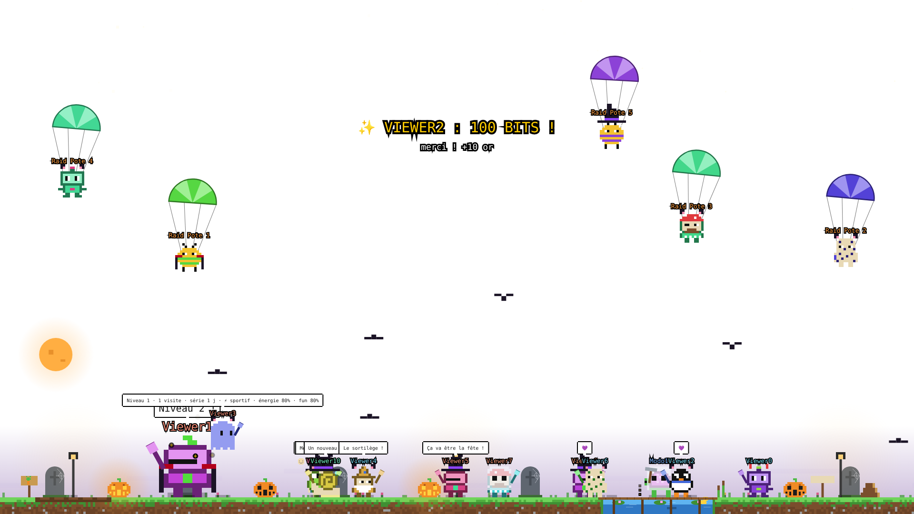

> Créé par **Appo** (PingHeberg) pour la chaîne [twitch.tv/hynatadj](https://www.twitch.tv/hynatadj), où ils tournent en direct.
> Aussi en service chez [DrDrenelle_live](https://www.twitch.tv/drdrenelle_live).

**Sommaire** : [Galerie](#-galerie) · [L'idée](#-lidée) · [Comment c'est fait](#️-comment-cest-fait) · [De la v1 à la v2](#-les-étapes-de-la-v1-à-la-v2) · [Ce que font les Pixous](#-ce-que-font-les-pixous) · [Les événements](#-les-événements) · [Halloween](#-halloween) · [Commandes viewers](#-commandes-viewers) · [Commandes modos](#️-commandes-modos) · [Le panneau F1](#️-le-panneau-de-réglages-f1) · [Raccourcis clavier](#️-raccourcis-clavier) · [Installation](#-installation) · [Et après](#️-et-après)

---

## 📸 Galerie

| | |
|---|---|
| 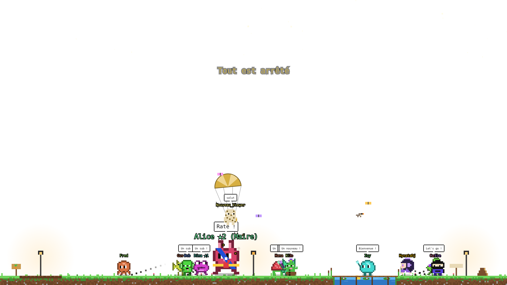 **Nuit à l'heure réelle** | 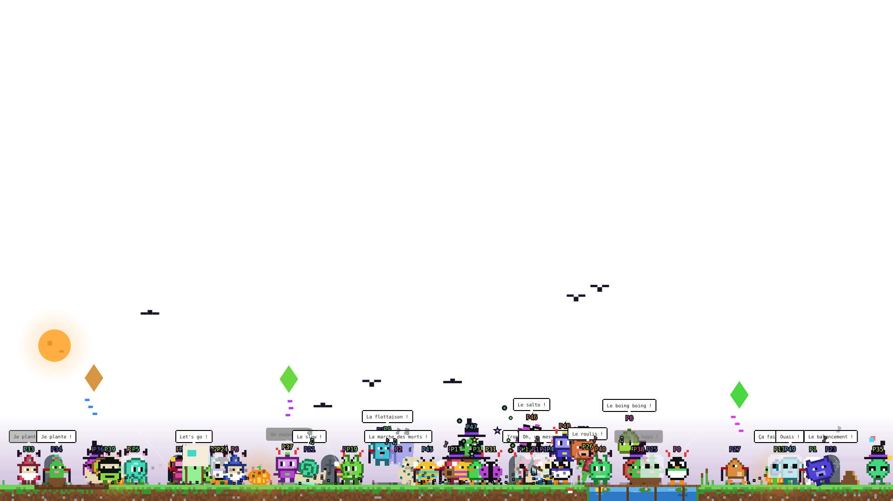 **50 Pixous à l'écran** |
| 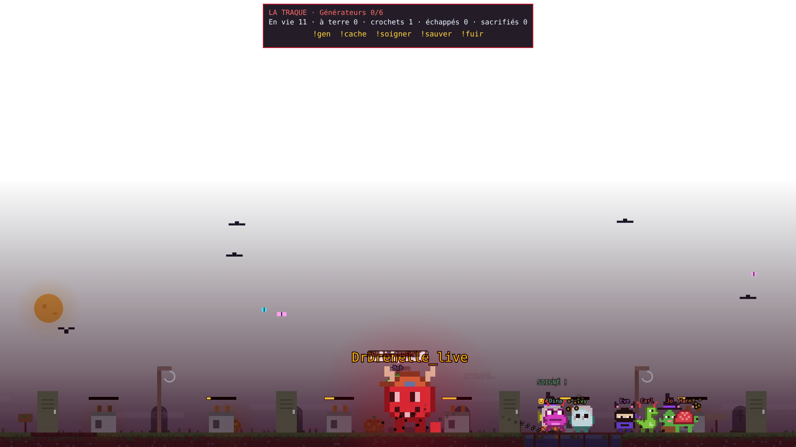 **La Traque** | 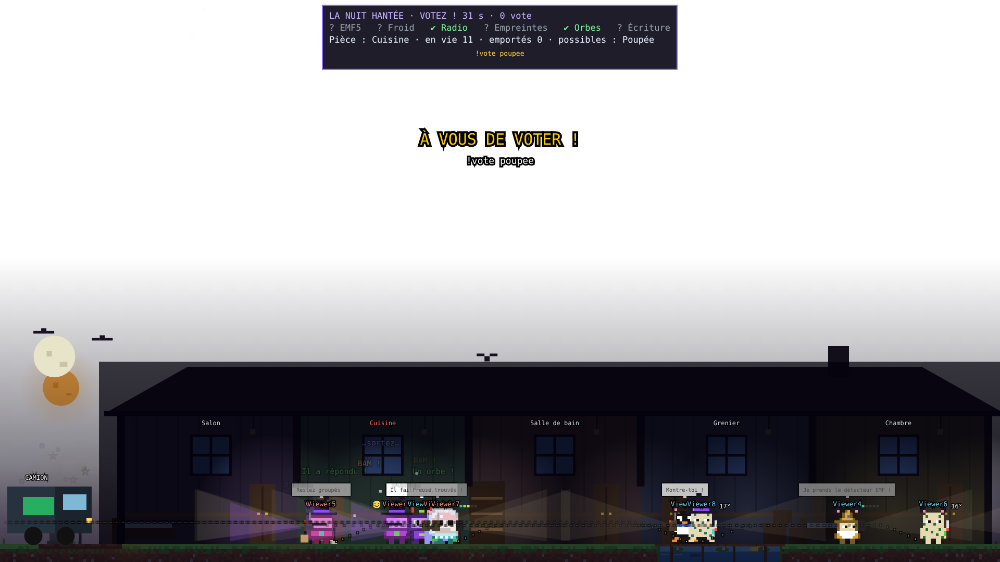 **La Nuit hantée** |
| 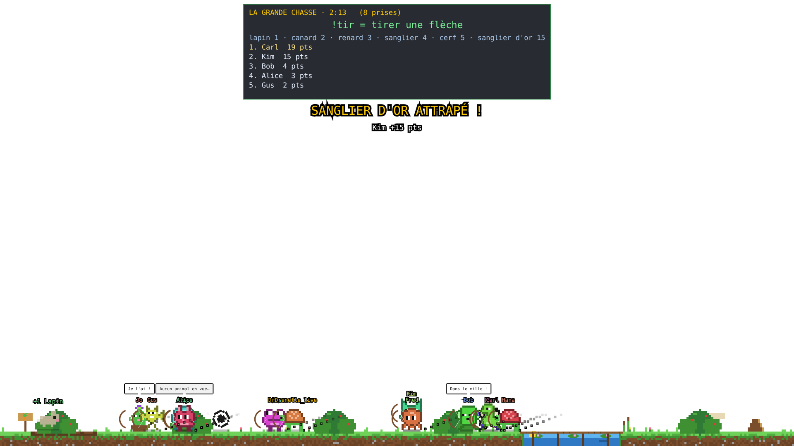 **La Grande Chasse** | 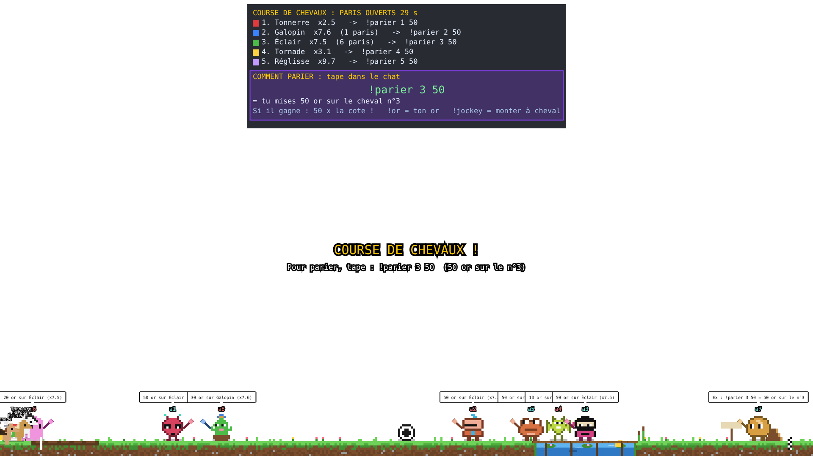 **Course de chevaux** |
| 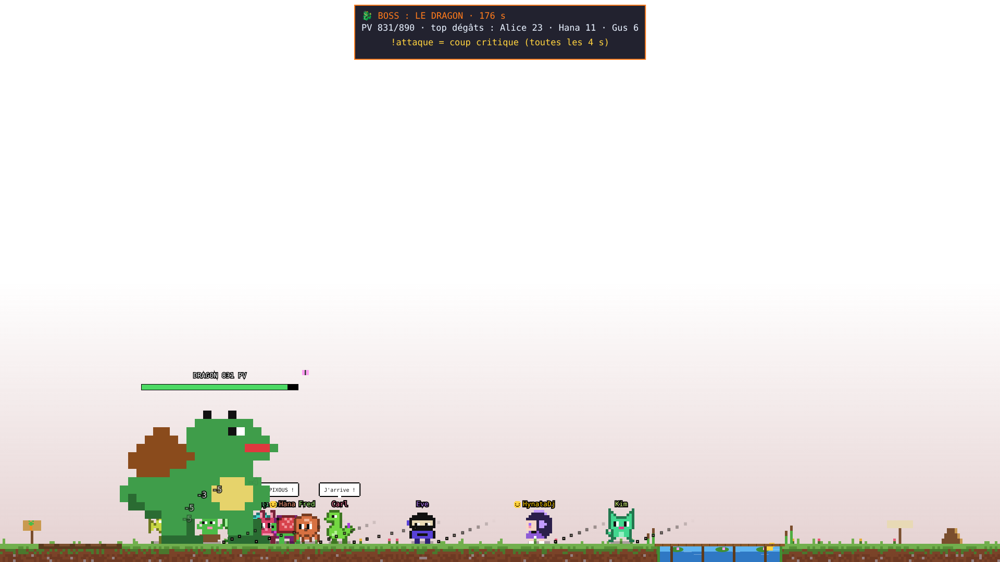 **Boss : le dragon** | 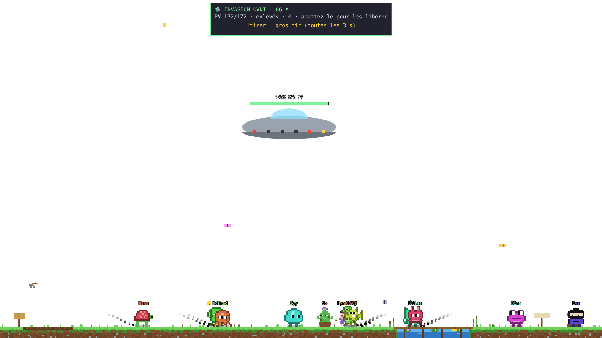 **Invasion OVNI** |
| 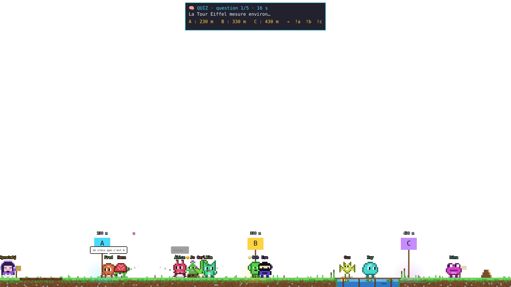 **Quiz** | 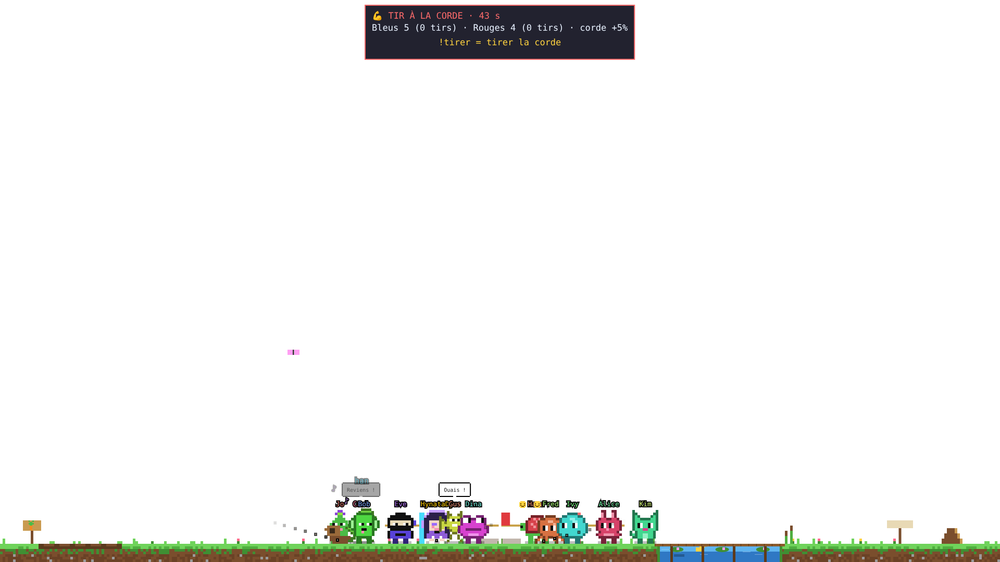 **Tir à la corde** |
| 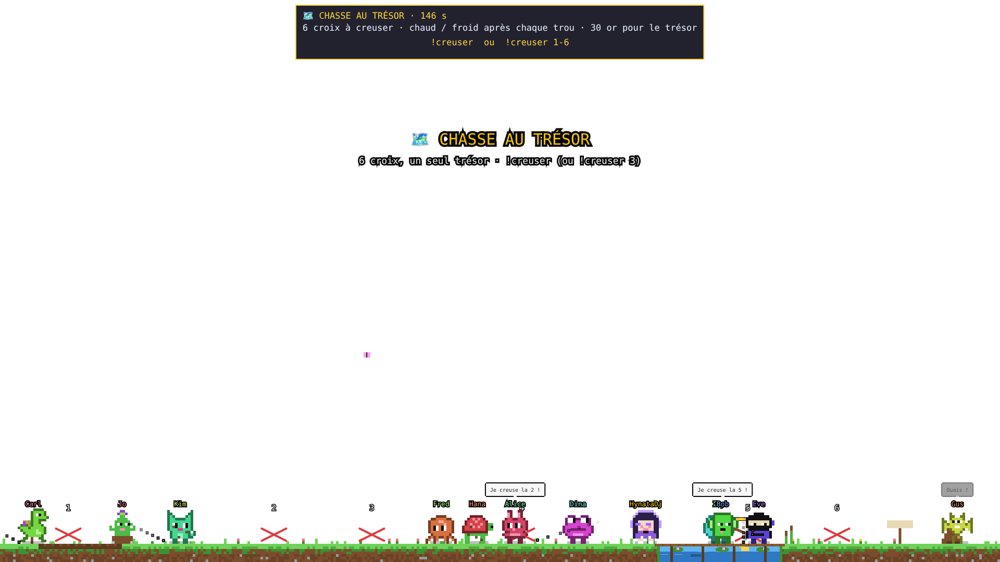 **Chasse au trésor** | 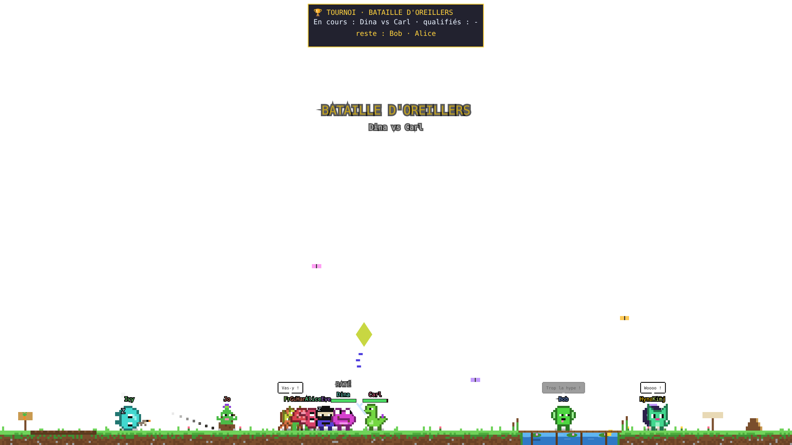 **Tournoi de duels** |
| 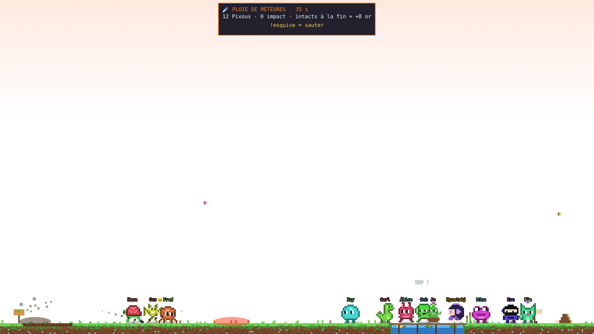 **Pluie de météores** | 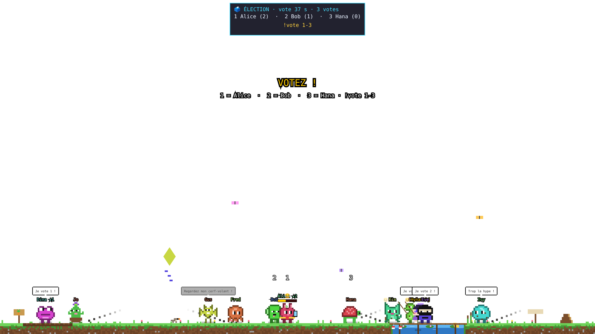 **Élection du maire** |
| 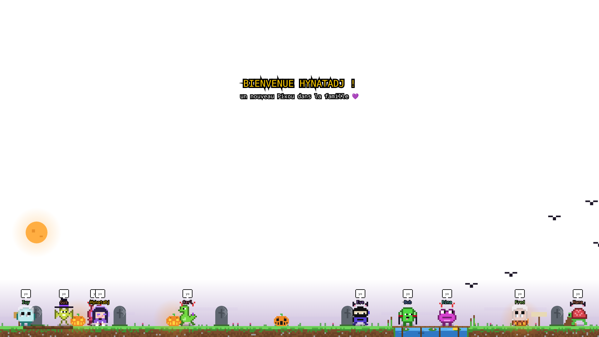 **Halloween** | 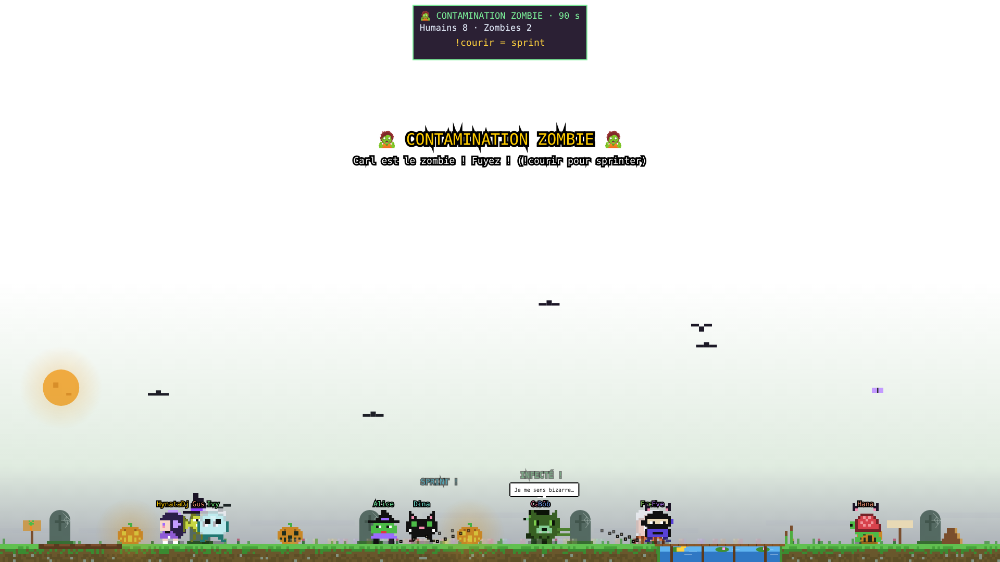 **Zombies** |

---

## 💡 L'idée

HynataDj streame **sans micro**. Pas de voix, pas de face cam : tout l'échange avec le chat passe par l'écrit. Il fallait donc quelque chose qui rende le chat **visible, vivant et amusant**, pour que chaque message compte et que les viewers aient une raison de rester, de revenir et de parler entre eux.

Les Pixous sont nés de ça : au lieu d'un simple overlay de chat, un **petit monde** où chaque viewer a un corps, un caractère, un inventaire, des amis, une histoire… et où le streamer est un personnage parmi les autres.

Principes de départ, jamais abandonnés :

- **Zéro friction** : un fichier `.html`, pas de bot à héberger, pas de token, pas de compte. Connexion anonyme au chat Twitch en lecture seule.
- **Le chat joue, le streamer regarde** : tout se déclenche par des commandes, les modos lancent les événements, le streamer n'a rien à cliquer en plein jeu.
- **Rien n'est perdu** : or, objets, poissons, caractère, niveau… tout est sauvegardé dans le navigateur d'OBS.
- **Ça doit vivre tout seul** : même quand personne ne parle, il se passe quelque chose à l'écran.

---

## 🛠️ Comment c'est fait

| | |
|---|---|
| **Langage** | HTML + JavaScript pur, aucune dépendance, aucun framework |
| **Rendu** | Canvas 2D, sprites pixel art dessinés en code (chaînes de caractères → pixels) |
| **Chat** | WebSocket IRC Twitch anonyme (`justinfan`), lecture des tags, des USERNOTICE (raids, subs) et des bits |
| **Sauvegarde** | `localStorage` du navigateur OBS (or, objets, poissons, persos, caractères, niveaux, maire, champion, bonbons, réglages) |
| **Réglages** | Panneau intégré (touche **F1**) : 5 onglets, tout se règle en live |
| **Taille** | ~8 700 lignes dans un seul fichier |

Les personnages sont des **sprites 12×14 pixels** animés (marche, saut, danse, sommeil, combat, pêche, parachute…), avec un système d'« actes » : chaque activité est un petit scénario (aller quelque part → faire quelque chose → finir) qui peut être interrompu proprement par un événement.

---

## 📜 Les étapes, de la v1 à la v2

### Étape 1 : les avatars (le tout début)
Un viewer écrit → un perso apparaît et marche. Pseudo au-dessus de la tête, couleur du chat Twitch, disparition après 10 min de silence. Premières commandes : `!perso`, `!coucou`, `!jump`, `!danse`, `!dodo`.

### Étape 2 : la vie
- Faim et soif, nourriture à acheter (`!faim`, `!soif`, `!acheter`, `!boutique`)
- L'**or** comme monnaie de tout le reste (`!or`, `!top`)
- Pêche dans l'étang avec 7 poissons dont le doré (`!peche`, `!poissons`)
- Potager, cabane à construire ensemble, bain, fusées qui explosent une fois sur deux
- Un chat, des papillons, des lucioles, la météo réelle (pluie, neige, orage)
- Amitiés et rivalités : les Pixous se parlent (45+ dialogues avec mimiques), se font des câlins, des high five… ou se regardent de travers

### Étape 3 : les combats et les objets
- Duels (`!duel`, `!accept`) avec 6 styles d'armes, bagarre générale
- Boutique d'objets et de familiers (balai, grimoire, chauve-souris, corbeau, œil volant…) avec leur animation propre (`!magasin`, `!equiper`)
- Le **démon**, perso réservé au streamer, prêtable à un viewer

### Étape 4 : les événements
Le chat devient un jeu :
- 🐎 Course de chevaux avec paris et cotes
- ⚽ Match de foot en deux équipes, 🎤 concert DJ, 🔥 feu de camp, 🙈 cache-cache, 🎁 cadeau du ciel, 🏠 chantier
- 🐦 Le pigeon partenaire qui fait passer les partenaires du stream
- 🏹 **La Grande Chasse** : tir à l'arc sur lapins, canards, renards, sangliers, cerfs et le sanglier d'or

### Étape 5 : les gros modes de jeu
- 🩸 **La Traque** (façon Dead by Daylight) : le streamer devient un monstre géant, les viewers réparent des générateurs, se cachent dans des casiers, se décrochent des crochets et fuient par les sorties
- 👻 **La Nuit Hantée** (façon Phasmophobia) : maison hantée, fantôme caché, 6 appareils (EMF, thermomètre, radio, UV, caméra, carnet), santé mentale, chasse, vote du bon fantôme

### Étape 6 : le panneau F1, la version publique et la version DrDrenelle
Un panneau de réglages complet dans l'overlay (tout lancer, tout régler, tout couper sans toucher au code). Le fichier est nettoyé pour être installable par n'importe quel streamer : chaîne, partenaires, Discord et liens en haut du fichier, rien d'autre à toucher. Une version dédiée est installée chez DrDrenelle_live, avec les droits croisés entre les deux chaînes.

### Étape 7 : Halloween, le premier mode saisonnier
Actif tout seul du 15 octobre au 2 novembre : cimetière, Pixous déguisés, 4 persos de saison, bonbons, sorts, citrouille géante à sculpter, citrouille cachée, zombies, concours de costumes, bal des monstres, magasin à -50 %… et une **couronne dorée toute l'année** pour le roi ou la reine des bonbons.

### Étape 8 : les Pixous v2, « plus vivants, plus intelligents »
La refonte du cerveau :
- 🧠 **8 personnalités** qui changent vraiment le comportement
- ⚡ **Besoins** : énergie (ils s'endorment vraiment) et fun (ils cherchent une activité)
- 🎨 **13 activités d'ambiance**
- 💬 **Compréhension du chat** (rires, gg, cœurs, majuscules, questions, mentions @)
- 💾 **Mémoire** : bienvenue aux nouveaux, retour des absents, séries de jours, **niveaux et XP** avec badges
- 🌙 **Jour et nuit à l'heure réelle**
- 📺 **Événements Twitch** : raids, subs, bits
- 🎉 **8 nouveaux événements** : quiz, tir à la corde, boss dragon, chasse au trésor, tournoi, météores, OVNI, élection du maire
- ⏰ Un événement se lance tout seul toutes les ~35 min si le chat ne fait rien

---

## 🧍 Ce que font les Pixous

### Arrivée et départ
Premier message → le Pixou descend en **parachute**. 10 minutes sans message → il s'en va doucement (il revient avec tout ce qu'il avait). Un nouveau a droit à une **fête de bienvenue** : les voisins viennent lui dire bonjour. Un absent depuis plus d'une semaine : « Te revoilà, tu nous as manqué ! ».

### Les persos (31 + saisonniers)
blob, chat, robot, fantome, slime, chevalier, grenouille, champi, lapin, ours, pingouin, poussin, alien, pieuvre, dino, vampire, ninja, pirate, sorcier, abeille, coccinelle, escargot, citrouille, squelette, momie, chien, hibou, cactus, tortue, chauvesouris.
Le **démon** est réservé au streamer (prêtable). Hynata a son perso à elle sur sa chaîne.

### Les 8 personnalités (v2)
| | Caractère | Ce que ça change |
|---|---|---|
| 😜 | **farceur** | fait des farces (BOUH, pousse les autres) |
| 🍕 | **gourmand** | a faim plus vite, réagit dès qu'on parle de pizza |
| ⚡ | **sportif** | court, saute, fort au tir à la corde |
| ☁️ | **rêveur** | lit, regarde les étoiles, flâne |
| 🙈 | **timide** | reste à l'écart, sursaute, fuit les bagarres |
| 👊 | **bagarreur** | provoque des duels tout seul |
| 🔍 | **curieux** | va voir tout ce qui bouge, se trompe moins au quiz |
| 🎉 | **fêtard** | danse tout le temps |

### Besoins
- **Faim et soif** : un Pixou affamé ralentit et râle, il faut le nourrir (`!faim`, `!acheter`) ou un modo le fait.
- **Énergie** (v2) : un Pixou crevé s'endort tout seul, plus la nuit.
- **Fun** (v2) : quand il s'ennuie, il cherche une activité.

### Activités tout seuls
Pêche, fouille d'or, jardinage, construction de la cabane, bain, caresser le chat, siestes, danses spontanées, discussions (45+ dialogues avec mimiques), câlins, poignées de main, high five, regards de travers entre rivaux.
**v2** : lire 📖, téléphone 📱, cerf-volant 🪁, jongler 🤹, guitare 🎸, peindre un autre Pixou 🎨, s'étirer, regarder les étoiles 🌠, sauter dans les flaques 💦, boules de neige ❄️, pique-nique entre meilleurs amis 🧺, farces, inspecter.

### Ils comprennent le chat (v2)
`mdr` / `lol` / `ptdr` → ils rigolent · `gg` / `bravo` → ils applaudissent · `<3` / `love` → des cœurs · `bonne nuit` → ils te disent au revoir · un message EN MAJUSCULES → ils sursautent · une question → un voisin répond · **@pseudo** → ton Pixou va voir l'autre (et lui fait un câlin si tu écris « câlin »).

### Mémoire, niveaux, titres (v2)
- **XP** en parlant et dans les événements. Niveau = badge bronze / argent / or (niv. 5 / 10 / 25) à côté du pseudo, or offert tous les 5 niveaux.
- **Série de jours** : venir plusieurs jours de suite → 🔥 bonus d'or tous les 3 jours.
- **Maire** 🎖️ : écharpe 24 h, « (Maire) » dans le nom, +1 or par minute.
- **Champion** 🏆 : ceinture dorée 24 h.
- **Roi / Reine d'Halloween** 👑 : couronne toute l'année.

### Le monde
Étang avec poissons, potager, cabane, feu de camp, chat, papillons, lucioles. **Météo réelle** : pluie (parapluies, flaques), neige (bonhommes de neige, boules de neige), orage (ils se mettent à l'abri). **Jour / nuit à l'heure réelle** (v2) : étoiles, lanternes, aube. Terrains : herbe, sable, pierre, neige, lave, nuit, aucun.

### Twitch (v2)
- **Raid** → jusqu'à 15 visiteurs débarquent en parachute et restent 2 min
- **Sub / resub / sub offert** → bannière, Pixou géant 90 s, +25 or
- **Bits** → bannière et pluie d'or

---

## 🎉 Les événements

Un seul grand événement à la fois. Hors événement, le Pixou obéit tout de suite aux commandes.

### Classiques
| Événement | Comment ça marche | Gains |
|---|---|---|
| 🐎 **Course de chevaux** | 30 s pour parier : `!parier 3 50` (cheval 3, 50 or), `!cotes`, `!jockey` pour monter. 200 or max | mise × cote |
| 🏹 **Grande Chasse** (2 min 30) | `!tir` toutes les 2,5 s. Lapin 1, canard 2, renard 3, sanglier 4 (il fonce), cerf 5, **sanglier d'or 15** (rare, esquive) | 1 or / point, +30 au Roi de la chasse |
| ⚽ **Match de foot** | 2 équipes, 5 min | 5 or / but, 10 or / joueur gagnant |
| 🎤 **Concert DJ** | tout le monde danse | 2 or / danseur |
| 🙈 **Cache-cache** | un chercheur, les autres se cachent | 5 or aux jamais trouvés et au chercheur |
| 🔥 **Feu de camp** | tout le monde autour du feu | — |
| 🏠 **Chantier cabane** | `!construire` pour aider | or à la fin |
| 🎁 **Cadeau du ciel** | courez l'attraper | or ou objet |
| 👊 **Bagarre générale** | tout le monde, avec l'arme choisie | or au dernier debout |
| 🐦 **Pigeon partenaire** | fait passer les partenaires du stream | — |

### Les gros modes
**🩸 La Traque** (façon Dead by Daylight) : le streamer devient un **monstre géant**. `!gen` réparer les générateurs · `!cache` casier · `!soigner` un pote blessé · `!sauver` décrocher du crochet · `!fuir` quand les sorties sont ouvertes. Crochet : 1re fois 40 s pour être sauvé, 2e fois 25 s, 3e fois sacrifié. 15 or si tu t'en sors.

**👻 La Nuit Hantée** (façon Phasmophobia) : maison hantée, un fantôme caché dans une pièce, 3 indices à relever, vote du bon fantôme. Appareils : `!emf` `!thermo` `!radio` `!uv` `!camera` `!carnet` · `!question` lui parler · `!cache` armoire · `!van` retour au camion · `!encens` le repousser (3 par partie) · `!fantomes` les possibles · `!vote dame` (dame, frappeur, follet, ombre, goule, croque, pendu, poupee). La santé mentale baisse dans le noir → trop basse, **il chasse**. 15 or si bonne réponse, +10 si tu as voté juste.

### Nouveaux v2
| Événement | Comment ça marche | Gains |
|---|---|---|
| 🧠 **Quiz** | 5 questions, 3 zones A/B/C au sol, `!a` `!b` `!c` → ton Pixou court vers la zone. Les sans-réponse choisissent tout seuls | 4 or / point, +10 au gagnant |
| 💪 **Tir à la corde** | bleus vs rouges, **spammez `!tirer`**. Les perdants finissent dans la boue | +10 or aux gagnants |
| 🐉 **Boss : le dragon** | les Pixous attaquent tout seuls, `!attaque` = critique (toutes les 4 s). Souffle de feu et piétinement. 3 min | pluie d'or selon les dégâts, MVP |
| 🗺️ **Chasse au trésor** | 6 croix, un seul trésor. `!creuser` ou `!creuser 3`, indice chaud / froid à chaque trou | 30 or, 3 aux autres |
| 🏆 **Tournoi de duels** | `!tournoi` pour s'inscrire (30 s, 4 ou 8). Duels éliminatoires | 25 or + ceinture 24 h |
| ☄️ **Pluie de météores** (40 s) | évitez les ombres rouges, `!esquive` pour sauter | +8 or si intact |
| 🛸 **Invasion OVNI** | il enlève les Pixous avec son rayon. `!tirer` = gros tir (toutes les 3 s). L'abattre libère tout le monde | +10 or aux tireurs |
| 🎖️ **Élection du maire** | `!candidat` (20 s) puis `!vote 1` à `3` (40 s) | écharpe 24 h, +1 or / min |

---

## 🎃 Halloween

Actif tout seul du **15 octobre au 2 novembre** (ou forcé par un modo). Décor cimetière, tous les Pixous déguisés, 4 persos de saison : `!perso sorciere` `loupgarou` `monstre` `chatnoir`.

- `!deguisement` (sorciere, drap, vampire, chat, diable)
- 🍬 `!bonbon` → des bonbons… ou un sort de 30 s (citrouille, fantôme, mini, tête en bas) · `!bonbons` ton stock · `!topbonbons`
- 🎃 **Citrouille géante** : `!sculpter` tous ensemble → pluie de bonbons
- 🔍 **Citrouille cachée** : le premier `!citrouille` la ramasse (+3)
- 🧟 **Zombies** : un infecté contamine les autres, `!courir` pour sprinter, dernier survivant +20 bonbons
- 👗 **Concours de costumes** : `!vote 1` à `5`, gagnant +15 bonbons
- 💀 **Bal des monstres** (le concert) · 🛍️ magasin à -50 % · bonbons bonus dans la Traque et la Nuit hantée
- 👑 Le n°1 des bonbons à la fin devient **Roi / Reine d'Halloween** : couronne dorée toute l'année

---

## 📋 Commandes viewers

### Perso
| Commande | Effet |
|---|---|
| `!perso nom` | changer de perso (`!perso` = au hasard) |
| `!persos` | la liste des persos |
| `!caractere` | ta personnalité · `!caractere sportif` pour la choisir (v2) |
| `!profil` / `!niveau` | niveau, visites, série, personnalité, énergie, fun (v2) |
| `!coucou` `!jump` `!danse` `!dodo` | les bases |
| `!humeur` · `!amis` · `!etat` | humeur, meilleur ami, faim et soif |

### Vie quotidienne
| Commande | Effet |
|---|---|
| `!faim` / `!soif` | demander à manger / à boire |
| `!acheter pizza` | pomme, burger, cookie, eau, soda, jus · `!boutique` les prix |
| `!peche` · `!poissons` | pêcher, voir tes prises (le poisson doré vaut 25 or) |
| `!bain` · `!jardiner` · `!potager` | se laver, jardiner, voir le potager |
| `!construire` · `!cabane` | aider au chantier, voir l'avancement |
| `!caresser` | caresser le chat |
| `!fusee` | ta fusée décolle… réussite +5 or, sinon BOUM |

### Or, objets, duels
| Commande | Effet |
|---|---|
| `!or` · `!top` | ton or et ton rang, le classement |
| `!magasin` | les objets : dents 60 · citrouille 80 · araignee 100 · oeil 110 · chauvesouris 120 · corbeau 120 · chatnoir 130 · fantome 140 · balai 150 · grimoire 200 |
| `!acheter balai` · `!equiper balai` · `!enlever balai` · `!objets` | acheter, équiper, retirer, voir tes objets |
| `!duel` · `!duel @pseudo` · `!accept` | adversaire au hasard, défi (l'autre accepte) |
| `!duel epee` · `!armes` | choisir l'arme : poings, epee, pistolet, boxe, marteau, oreiller |

### Pendant les événements
| Événement | Commandes |
|---|---|
| Course | `!parier 3 50` · `!cotes` · `!jockey` |
| Chasse | `!tir` · `!trophees` |
| Traque | `!gen` · `!cache` · `!soigner` · `!sauver` · `!fuir` |
| Nuit hantée | `!emf` `!thermo` `!radio` `!uv` `!camera` `!carnet` · `!question` · `!cache` · `!van` · `!encens` · `!fantomes` · `!vote dame` |
| Quiz | `!a` `!b` `!c` (ou `!1` `!2` `!3`, `!rep a`) |
| Tir à la corde | `!tirer` |
| Dragon | `!attaque` |
| Trésor | `!creuser` · `!creuser 3` |
| Tournoi | `!tournoi` pour s'inscrire |
| Météores | `!esquive` |
| OVNI | `!tirer` |
| Élection | `!candidat` · `!vote 1` |
| Halloween | `!bonbon` · `!bonbons` · `!topbonbons` · `!deguisement` · `!sculpter` · `!citrouille` · `!courir` · `!vote 1` |

### Infos
`!discord` · `!site` · `!partenaires` · `!maire` · `!champion`

---

## 🛡️ Commandes modos

🛑 **`!stop`** arrête tout, quoi qu'il se passe.

### Lancer un événement (ajouter `stop` pour l'arrêter)
| Commande | Événement |
|---|---|
| `!course` | course de chevaux |
| `!chasse` | grande chasse |
| `!traque` · `!traque @pseudo` | la Traque (monstre = streamer ou le pseudo choisi) |
| `!fantome` · `!fantome vote` | la Nuit hantée, lancer le vote |
| `!concert` · `!feu` · `!cachecache` · `!cadeau` · `!partenaire` | concert, feu de camp, cache-cache, cadeau du ciel, pigeon |
| `!match` / `!stopmatch` · `!ballon` | match de foot, ballon libre |
| `!bagarre` · `!bagarre epee` | bagarre générale (avec l'arme) |
| `!cabane start/stop/reset` | chantier |
| `!boum` · `!reveil` | tout le monde danse, tout le monde se réveille |
| `!quiz` · `!corde` · `!boss` · `!tresor` · `!tournoi` · `!meteores` · `!ovni` · `!election` | événements v2 |
| `!halloween on/off/auto/fin` | forcer le mode, revenir en auto, clôturer (couronne) |
| `!zombie` · `!zombie @pseudo` · `!concours` · `!grossecitrouille` · `!cachercitrouille` | événements Halloween |

### Monde et soins
| Commande | Effet |
|---|---|
| `!manger @pseudo burger` · `!boire @pseudo soda` · `!manger all` | nourrir / abreuver (ou tout le monde) |
| `!bonus @pseudo 120` · `!bonus all` | Pixou géant X secondes |
| `!donneror @pseudo 50` | donner de l'or (négatif = retirer) |
| `!donnerobjet @pseudo balai` · `hasard` | offrir un objet |
| `!donnerbonbons @pseudo 10` | bonbons (Halloween) |
| `!terrain neige` | herbe, sable, pierre, neige, lave, nuit, aucun |
| `!meteo pluie` | soleil, pluie, neige, orage |

### Streamer uniquement
`!donnerdemon @pseudo` · `!reprendredemon @pseudo` · `!resetor` · `!resetitems` · `!resetall`

---

## ⚙️ Le panneau de réglages (F1)

Dans OBS : clic droit sur la source → **Interagir**, puis **F1** (ou **²**). Le panneau se ferme tout seul après 1 min sans action et il est visible en live tant qu'il est ouvert.

### Onglet « En direct »
- **TOUT ARRÊTER**
- **Événements** (un bouton par événement, allumé quand il tourne) : course, concert, bagarre, duel au hasard, match, cache-cache, feu de camp, cadeau du ciel, pigeon partenaire, la Traque, la Nuit hantée, mode Halloween, citrouille géante, zombies, concours costumes, citrouille cachée, quiz, tir à la corde, boss dragon, chasse au trésor, tournoi, météores, OVNI, élection, grande chasse, chantier cabane
- **Tout le monde** : danse, saute, coucou, va pêcher, fait dodo, réveil, interaction, fusée au hasard
- **Soins et cadeaux** : nourrir les affamés, abreuver les assoiffés, buffet pour tous, bonus au hasard, objet au hasard, pluie d'or (+10)
- **Monde** : ballon, terrain suivant
- **Cabane** : recommencer, démolir
- **Style des combats** : au hasard, poings, epee, pistolet, boxe, marteau, oreiller
- **Météo** : soleil, pluie, neige, orage · **Terrain** : herbe, sable, pierre, neige, lave, nuit, aucun

### Onglet « Temps »
Curseurs, appliqués tout de suite : faim (estomac vide en X min), soif, fouille d'or, cadeau du ciel, pigeon, interactions, siestes, danses spontanées (%), météo, feu de camp auto et sa durée, cache-cache auto, course auto et temps pour parier, durée du concert, durée d'un match, durée du bonus, chasse auto et sa durée, événement v2 auto (10 à 120 min). Bouton « Temps par défaut ».

### Onglet « Systèmes »
Interrupteurs : météo auto, animaux, feu de camp auto, potager, cabane, sculptures, cache-cache auto, discussions, siestes, pêche, fouille d'or, cadeaux, pigeon partenaires, danses spontanées, bains, course auto, chasse auto, jour / nuit, activités v2, réactions au chat, accueil des viewers, événements v2 auto.

### Onglet « Réglages »
Taille des Pixous (x3 à x8), panneau debug, classement de l'or à l'écran, demandes faim / soif à l'écran. Remises à zéro séparées (réglages, or, amitiés, objets, persos, pêche) et **TOUT RÉINITIALISER**, avec double clic de sécurité.

### Onglet « Viewers »
La liste des Pixous présents avec, pour chacun : +50 or, bonus, objet, nourrir.

---

## ⌨️ Raccourcis clavier

Dans la fenêtre « Interagir », panneau fermé :

| Touche | Action | Touche | Action |
|---|---|---|---|
| **F1** / **²** | panneau | **S** | tout arrêter |
| **J** | tout le monde saute | **C** | tout le monde fait coucou |
| **N** | tout le monde danse | **Z** | tout le monde dort |
| **E** | tout le monde pêche | **I** | interaction |
| **F** / **G** | nourrir / abreuver | **P** | bonus au hasard |
| **Y** | objet au hasard | **K** | cadeau du ciel |
| **R** | course | **A** | grande chasse |
| **M** | match | **L** | ballon |
| **V** | concert | **X** | feu de camp |
| **Q** | cache-cache | **U** | pigeon |
| **D** | duel au hasard | **B** | bagarre générale |
| **1** | boss dragon | **2** | quiz |
| **3** | la Nuit hantée | **4** | la Traque |
| **W** | météo suivante | **T** | terrain suivant |
| **H** | debug | **O** | classement de l'or |

---

## 📦 Installation

1. Ouvre le fichier dans un éditeur de texte et remplis le haut :
   ```js
   const DEFAULT_CHANNEL = 'machaine';   // ta chaîne Twitch en minuscules
   const PARTNERS = [ ... ];             // tes partenaires (facultatif)
   const DISCORD_LINK = 'discord.gg/xxxx';
   const SITE_LINK = '';
   ```
2. Dans OBS : **Sources → + → Navigateur → Fichier local**, 1920 × 1080, en bas de la scène.
3. Clic droit → **Interagir** → **F1** pour le panneau.
4. Écris dans ton chat : ton Pixou arrive en parachute.

Options dans l'adresse : `?channel=machaine` (chaîne), `?scale=6` (taille), `?afk=15` (minutes avant départ), `?ground=40` (décalage du sol), `?partners=0` (sans pigeon).

---

## 🗺️ Et après

- Modes saisonniers suivants (Noël, été)
- Nouveaux événements et nouveaux persos
- Version pour d'autres streamers, réglages sans toucher au code
- Une version **Steam** est à l'étude

---

## 📄 Licence et crédits

Les Pixous sont une création originale d'**Appo** (PingHeberg). Code, sprites et concept : tous droits réservés.
Pour installer les Pixous sur ta chaîne, passe par le [Discord](https://discord.gg/NRxyeycYnQ) ou par [PingHeberg](https://store.pingheberg.com).

🛡️ Modo permanent des Pixous : [Xeryth](https://www.twitch.tv/xeryth_fox)
💜 Partenaires : [PingHeberg](https://store.pingheberg.com) · [DrDrenelle_live](https://www.twitch.tv/drdrenelle_live) · Team Pasta Box
