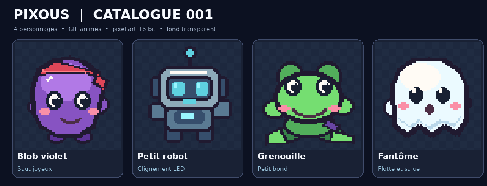
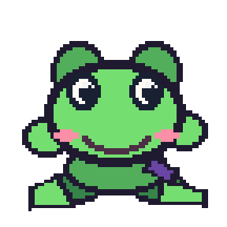

# 🎞️ Les Pixous — Catalogue de GIFs

[← Retour au projet LesPixous](../README.md) · [Voir le catalogue web](index.html) · [Données JSON](manifest.json)

> **Collection 001 — 4 GIFs animés** : style pixel art, 288 × 288 px, fond transparent et animation en boucle. Ces dessins sont des **concepts graphiques** : ils ne reproduisent pas encore à l’identique les sprites 12 × 14 pixels de l’overlay original.



## 🐾 Personnages animés

| Pixou | GIF animé | Animation | Télécharger |
|:--|:--:|:--|:--|
| **Blob violet** |  | Saut joyeux | [GIF](animations/01_blob_violet.gif) · [PNG](apercus/01_blob_violet_apercu.png) |
| **Petit robot** |  | Clignement des LED | [GIF](animations/02_robot.gif) · [PNG](apercus/02_robot_apercu.png) |
| **Grenouille** |  | Petit bond | [GIF](animations/03_grenouille.gif) · [PNG](apercus/03_grenouille_apercu.png) |
| **Fantôme** |  | Flotte et salue | [GIF](animations/04_fantome.gif) · [PNG](apercus/04_fantome_apercu.png) |

## 📁 Organisation

```text
gifs/
├── README.md            ← Catalogue visible sur GitHub
├── index.html           ← Galerie web (activable avec GitHub Pages)
├── manifest.json        ← Index pour outil, site ou automatisation
├── animations/          ← GIF animés sur fond transparent
├── apercus/             ← Images PNG statiques
└── visuels/             ← Planche du catalogue
```

## 🧩 Intégration

Vous pouvez afficher un personnage dans un README, une page web ou une source navigateur OBS :

```html

```

> **Important :** l’exemple ci-dessus utilise un chemin relatif depuis la racine du dépôt. Depuis le dossier `gifs/`, enlevez le préfixe `gifs/`.

Les liens CDN GitHub bruts peuvent aussi servir dans une application externe après publication (avec une URL complète et un commit ou un tag précis de préférence).

## ➕ Ajouts à venir

La collection peut s’enrichir avec les personnages originaux (chat, ninja, pirate, dino, champignon, pingouin, etc.) et de nouvelles actions : marche, danse, dodo, pêche, combat et réactions au chat.

Conservez le nom d’origine d’un GIF déjà publié pour éviter de casser ses liens ; créez un nouvel identifiant pour une variante.

## © Crédits et utilisation

Collection de démonstration liée au projet **Les Pixous**, par Appo / PingHeberg. La présence des GIFs dans ce dépôt ne définit pas, à elle seule, une licence de réutilisation pour des tiers. Spécifier une licence explicite si une distribution externe est souhaitée.
