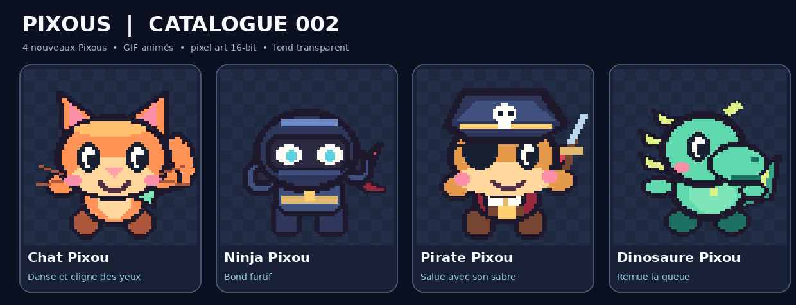
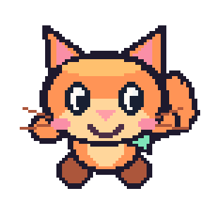
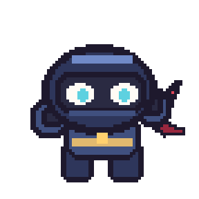
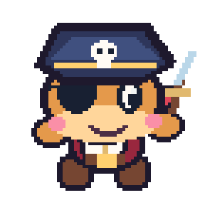
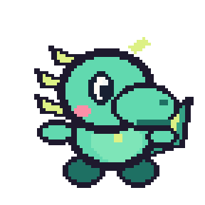

<h1>Les Pixous : catalogue des animations</h1>

Collection 001 et 002 : 8 GIFs animés sur fond transparent, en pixel art 16-bit.

<h2>Personnages et animations</h2>

| Pixou | Animation | GIF |
|:--|:--|:--:|
| Blob violet | Saut joyeux |  |
| Petit robot | LED clignotantes |  |
| Grenouille | Petit bond |  |
| Fantôme | Flottement et salut |  |
| Chat Pixou | Danse et cligne des yeux |  |
| Ninja Pixou | Bond furtif |  |
| Pirate Pixou | Salue avec son sabre |  |
| Dinosaure Pixou | Remue la queue |  |

<h2>Téléchargement</h2>

Les GIFs sont dans le dossier `animations/`. Les PNG fixes sont dans `apercus/`.
Le fichier `manifest.json` contient les liens et les informations techniques de chaque animation.

Ces GIFs sont des concepts graphiques. Ils ne remplacent pas les sprites originaux du jeu ou de l’overlay.

Créations pour le projet LesPixous, PingHeberg.
